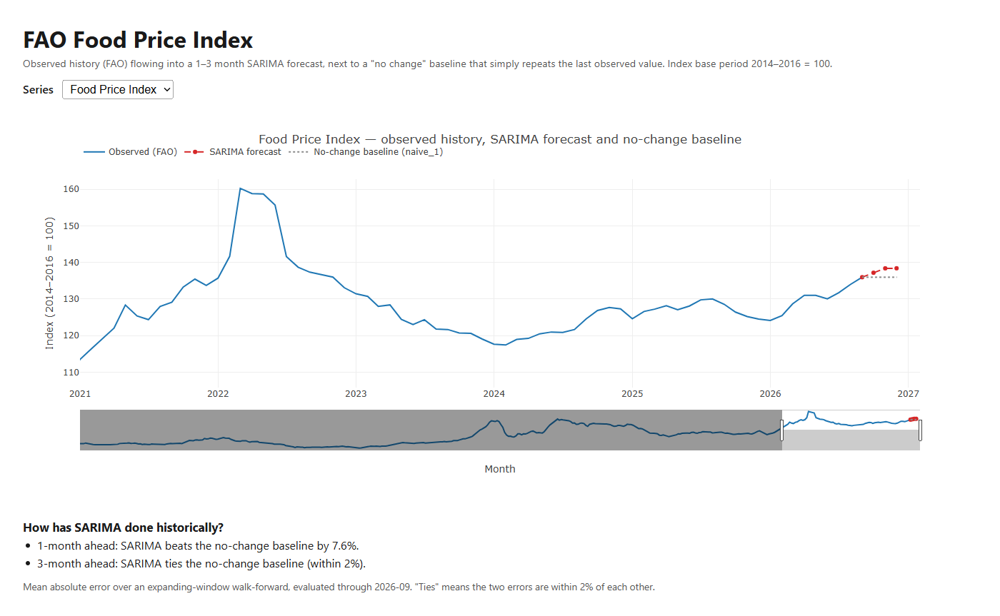

# Food Price Intel

Monthly forecasting of the **FAO Food Price Index (FFPI)** and its five sub-indices — a containerized Django app that ingests FAO's published data, forecasts each series with SARIMA, and shows every forecast next to the baseline it has to beat.

**Live:** https://food-price-intel.onrender.com/forecast/



---

## What the chart shows

Six series, one selector: **Food Price Index** (the overall FFPI), **Cereals**, **Vegetable Oils**, **Dairy**, **Meat** and **Sugar** (FAO index, 2014–2016 = 100). The choice is in the URL, so views are shareable — e.g. [`/forecast/?series=sugar`](https://food-price-intel.onrender.com/forecast/?series=sugar).

For the selected series the chart draws three lines:

- **Observed (FAO)** — solid. The published monthly history from 1990.
- **SARIMA forecast** — dashed. The next 3 months, from the latest forecast run.
- **No-change baseline (`naive_1`)** — dotted grey. The last observed value repeated forward: "next month = this month".

Both forecast lines leave the observed line from the same month (the run's training cutoff), so the gap between them *is* the model's contribution. Below the chart, the series' walk-forward verdict at 1 and 3 months is stated in plain words — *"SARIMA beats / ties / is worse than the no-change baseline by N%"* — straight from the scoreboard below.

---

## The scoreboard

<!-- scoreboard:start (generated by `manage.py render_scoreboard`; do not edit) -->
Evaluated through **2026-09** — expanding-window walk-forward from 2015-12, SARIMA(1,1,1)(1,1,1,12) vs the no-change baseline (`naive_1`) on identical folds. *Ties* = MAEs within 2% of each other.

| series | horizon | folds | SARIMA MAE | no-change MAE | Δ | SARIMA … |
|---|---|---|---|---|---|---|
| Food Price Index | 1 month | 129 | 1.704 | 1.844 | -7.6% | **beats** the baseline |
| Food Price Index | 3 months | 127 | 4.285 | 4.309 | -0.6% | **ties** the baseline |
| Cereals | 1 month | 129 | 2.778 | 2.750 | +1.0% | **ties** the baseline |
| Cereals | 3 months | 127 | 5.894 | 5.468 | +7.8% | **loses to** the baseline |
| Vegetable Oils | 1 month | 129 | 5.566 | 5.694 | -2.3% | **beats** the baseline |
| Vegetable Oils | 3 months | 127 | 12.537 | 12.057 | +4.0% | **loses to** the baseline |
| Dairy | 1 month | 129 | 2.072 | 2.579 | -19.6% | **beats** the baseline |
| Dairy | 3 months | 127 | 5.701 | 6.627 | -14.0% | **beats** the baseline |
| Meat | 1 month | 129 | 1.197 | 1.534 | -21.9% | **beats** the baseline |
| Meat | 3 months | 127 | 2.948 | 3.611 | -18.4% | **beats** the baseline |
| Sugar | 1 month | 129 | 5.259 | 4.924 | +6.8% | **loses to** the baseline |
| Sugar | 3 months | 127 | 10.249 | 9.527 | +7.6% | **loses to** the baseline |

**Totals (12 series × horizons):** SARIMA beats the baseline 6, ties 2, loses 4.
<!-- scoreboard:end -->

The table above is **generated, not typed**: `evaluate_sarima --summarize --out` writes [`data/seed/scoreboard.json`](data/seed/scoreboard.json) from the per-series walk-forward runs, `render_scoreboard` writes this table from that file, and a test fails if the two ever disagree. Verdicts come from one function: *ties* if `|SARIMA MAE − baseline MAE| / baseline MAE < 2%`, otherwise *beats* or *loses* by sign.

Losses are reported, not tuned away: the model order is the same documented default on every series, and a series where the no-change baseline wins is a real finding about that market, not something to hide.

---

## Why the baseline matters more than the model

Most forecasting write-ups report an error metric with nothing to compare it against. A number alone is unfalsifiable.

This project established the bar **before** building a model, and the bar turned out to be surprising. On the overall index (Phase 3, data through 2026-05):

- **seasonal_naive** (next month = same month last year) scored MAE **10.03**. Easy to beat.
- **naive_1** (next month = this month — a one-line random walk) scored MAE **1.85**. Very hard to beat.

The FFPI is highly persistent month-to-month, so simply carrying the last value forward is a genuinely strong forecast, while seasonal-naive throws away a year of level drift. **A model that beats seasonal-naive but loses to `naive_1` is worse than one line of code** — which is why `naive_1` is the line drawn on the chart and the bar in the scoreboard.

A *large* improvement over a random walk on series like these would be evidence of a bug, not a breakthrough. The walk-forward harness keeps a regression guard: on the overall index with `--eval-end 2026-05` it must still reproduce the recorded Phase 3 `naive_1` MAE, so changes to the harness can't quietly move the goalposts.

---

## Leakage: proven caught, not assumed absent

Look-ahead leakage is the failure mode that makes a forecaster look excellent in validation and collapse in production. It is silent: it produces *better* numbers, not errors.

This repo includes a leakage probe (`apps/forecasting/tests/test_leakage.py`) that mutates every value **after** each walk-forward cutoff and asserts the prediction for that fold is byte-identical. If any future data influences a past prediction, the test fails.

Critically, the probe is verified to **bite**:

- A real look-ahead leak was deliberately planted in the forecaster → the test went **RED**, with the unmistakable signature `y_pred == y_true` (a leaking model predicts the answer exactly).
- The leak was reverted → **GREEN**.

A test that passes because it tests nothing is worse than no test. This one was shown to fail when it should.

The probe covers both the naive baselines and the SARIMA forecaster, which re-fits inside every fold on that fold's training window only — never once on the full series.

---

## Predictions never touch observations

Forecasts are stored in dedicated tables (`ForecastRun`, `ForecastPoint`), **never** in the observations table (`PriceIndexMonthly`). The no-change baseline isn't stored at all — the API derives it per request from the observed value at the run's training cutoff.

This is structural, not conventional. The moment a prediction is written into the observations table, the next model training cannot distinguish fact from guess, and the model slowly learns to predict itself. Keeping them in separate tables makes that failure impossible rather than merely discouraged. Every `generate_forecast` run asserts `PriceIndexMonthly.objects.count()` is unchanged afterwards.

**Provenance is preserved.** Each `ForecastRun` is an immutable, append-only record of *what the model predicted at a given moment, for a given series, fitted through a given `train_end`* — including the SARIMA orders in `model_params`. Re-forecasting creates a new run rather than overwriting the old one, which is what makes the question *"was our June forecast any good?"* answerable six months later. The API serves only the latest run per series.

---

## Data integrity

**Base-period checksum.** The FAO index is defined as `2014-2016 = 100`. The mean of the parsed OVERALL series over 2014-01 → 2016-12 is ≈ 100 (measured: **99.9989**, n=36). This is a free correctness oracle that falls out of the data's own definition — if the header row shifts, the nominal/real sheets swap, or FAO republishes on a new base, this number moves visibly.

**Revision-safe upserts.** FAO quietly revises recent months with each monthly release. Ingestion is keyed on `(commodity_group, period)` via `update_or_create`, so revisions **update in place** rather than duplicating. Each refresh snapshots every value before ingesting and diffs afterwards, so revisions are reported, not just absorbed.

**Full precision preserved.** FAO's workbook displays values rounded to one decimal (e.g. `128.6`) but stores full precision (`128.568848888328`). The parser stores the full value; rounding is a display concern only.

---

## Architecture

```
FAO FFPI workbook (.xlsx)
        ↓  ingest_ffpi           — revision-safe upsert, 6 series × 1 row per month
   PriceIndexMonthly              — observed data only
        ↓  evaluate_sarima --group X --json      (one series per command)
        ↓  evaluate_sarima --summarize --out     → data/seed/scoreboard.json
        ↓  render_scoreboard                     → README scoreboard table
        ↓  generate_forecast --group X           — fit on full series, forecast 3 months
   ForecastRun / ForecastPoint    — predictions + provenance, isolated from observations
        ↓  /api/forecast/<series>/  — history + latest SARIMA run + no-change baseline + scoreboard
        ↓  /forecast/               — Plotly chart with series selector  ("/" redirects here)

Deploy (Render + Neon):
   export_observed_csv → data/seed/ffpi_observed.csv  (committed)
   start.sh on boot: migrate → seed_catalog → seed_from_csv → collectstatic → gunicorn
```

The walk-forward evaluation is too slow for the free-tier dyno, so production never runs it: the scoreboard ships as a committed file, and the observed data ships as a committed CSV (no xlsx in the deploy).

**Stack:** Django · PostgreSQL · Redis (local dev only; reserved for scheduled refresh) · Docker Compose · pandas · statsmodels · Plotly.js · Render + Neon

**Apps:** `catalog` (commodity groups, countries, data sources) · `prices` (observed series, ingest + seed) · `forecasting` (harness, models, forecasts, API, chart)

---

## Quickstart

Requires Docker Desktop.

```bash
# 1. Configure and bring up the stack
cp .env.example .env
docker compose up -d --build

# 2. Migrate, seed reference data, and load all 6 observed series from the committed CSV
docker compose exec web python manage.py migrate
docker compose exec web python manage.py seed_catalog
docker compose exec web python manage.py seed_from_csv

# 3. Forecast each series (SARIMA, 3 months ahead)
for g in OVERALL CEREALS OILS DAIRY MEAT SUGAR; do
  docker compose exec web python manage.py generate_forecast --group $g --horizon 3
done

# 4. Open the chart
#    http://localhost:8000/            (redirects to /forecast/)
#    http://localhost:8000/api/forecast/sugar/
```

Run the tests, including the leakage probe:

```bash
docker compose exec web pytest
```

To pull in a newer FAO release instead of the committed CSV, download the workbook to `data/raw/ffpi/` and run `ingest_ffpi --file …` — the full monthly procedure is in **[docs/REFRESH.md](docs/REFRESH.md)**.

### Obtaining the data

The FAO workbook is **not committed** — it's regenerable input data, not source, and FAO republishes it monthly. Download the Food Price Index data file from the [FAO Food Price Index page](https://www.fao.org/worldfoodsituation/foodpricesindex/en/) and place it in `data/raw/ffpi/`. What *is* committed is the exported observed series (`data/seed/ffpi_observed.csv`), which is all the app needs to run.

The ingest expects the monthly sheets `Indices_Monthly` (nominal) and `Indices_Monthly_Real` (real); the `Annual` sheets are ignored. The parser confirms the sheet structure programmatically before relying on it, and fails loudly on any missing column rather than silently dropping a series.

---

## API

`GET /api/forecast/<series>/` — `<series>` is one of `overall`, `cereals`, `oils`, `dairy`, `meat`, `sugar` (case-insensitive). Anything else is a JSON `404`.

```json
{
  "commodity_group": "OVERALL",
  "label": "Food Price Index",
  "history": [
    {"period": "1990-01", "value": 64.44},
    "…",
    {"period": "2026-09", "value": 135.96}
  ],
  "forecast": {
    "model": "sarima", "run_id": 15, "train_end": "2026-09",
    "points": [
      {"period": "2026-10", "horizon_step": 1, "value": 137.18},
      {"period": "2026-11", "horizon_step": 2, "value": 138.38},
      {"period": "2026-12", "horizon_step": 3, "value": 138.4}
    ]
  },
  "naive_forecast": {
    "model": "naive_1", "train_end": "2026-09", "anchor_value": 135.96,
    "points": [
      {"period": "2026-10", "horizon_step": 1, "value": 135.96},
      "…"
    ]
  },
  "scoreboard": {
    "eval_end": "2026-09", "tie_threshold": 0.02, "baseline": "naive_1",
    "horizons": {"1": {"sarima_mae": "…", "naive_1_mae": "…", "rel_delta": "…", "verdict": "BEATS", "folds": 129}, "3": "…"}
  }
}
```

(Values illustrative, from the 2026-09 data.)

- `forecast` is the **single most recent** SARIMA run for the series — points are never merged across runs. `null` if no run exists.
- `naive_forecast` is computed on request, anchored at that run's `train_end`, and covers the same periods. It is never stored.
- `scoreboard` comes from `data/seed/scoreboard.json`; `null` if the file or the series is missing.
- `/api/forecast/overall/` is the original Phase 6 endpoint; its original fields are unchanged.

---

## Notable dependency pin

`scipy==1.14.1` is pinned deliberately. scipy 1.18 removed the `disp` keyword that statsmodels 0.14.4 still passes to `fmin_l_bfgs_b`, which crashes SARIMAX fitting. 1.14.1 is the last compatible version.

---

## Scope and honest limitations

**Built:** containerized stack · FFPI ingestion with revision-safe upserts and per-refresh diffs · reference catalog · expanding-window walk-forward harness with baselines · verified leakage probe · SARIMA forecasts for all 6 series · forecast persistence with provenance · committed, generated scoreboard · JSON API · interactive chart with baseline comparison · deployed on Render + Neon with a CSV seed.

**Not built (deliberate):**

- **FAOSTAT country CPI ingestion.** The `CountryFoodCpiMonthly` table exists but is empty. FAOSTAT codes its areas differently from ISO/M49, so the country join is a real reconciliation task deferred to its own phase.
- **No SARIMA order search.** The order `(1,1,1)(1,1,1,12)` is a documented starting point, used untuned on every series. Tuning against the validation set until the number improves is itself a form of leakage; any future search must select orders using in-fold training data only. The series where SARIMA loses in the scoreboard are the obvious place to look — honestly.
- **No LightGBM.** The harness is built and leak-tested, so adding a second forecaster is cheap — but on ~440 monthly observations of random-walk-dominated series, gradient boosting may well lose to `naive_1`. That would be a finding worth reporting, not a failure.
- **Monthly refresh is manual.** It's a documented runbook ([docs/REFRESH.md](docs/REFRESH.md)), not a scheduled job.

---

## Development notes

Every phase was verified before being committed, and the verification is the point:

- Migrations confirmed with `makemigrations --check` reporting no changes, not just a clean `migrate`.
- Seed idempotency proven by a second run creating **zero** rows — including the full `start.sh` chain against a fresh, empty database.
- Ingestion revision-safety proven by mutating a source value and confirming an in-place update; every refresh reports FAO's revisions value by value.
- The leakage probe proven by planting a leak and watching it go red.
- Verdict boundaries pinned by tests (exactly 2.00% is a win or loss, 1.99% is a tie), and scoreboard totals counted in code, never retyped.
- The chart's traces, series switching, deep links, zoom bounds and double-click reset checked with real mouse input in a browser, not inferred from an HTTP 200.

Data source: [FAO Food Price Index](https://www.fao.org/worldfoodsituation/foodpricesindex/en/), CC BY 4.0.
